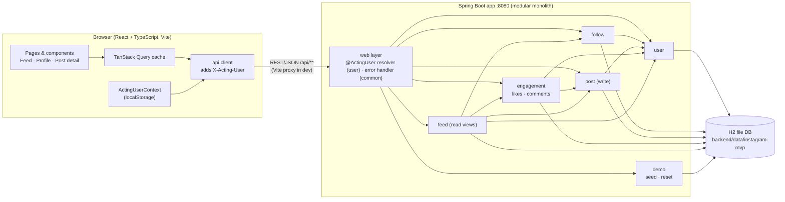
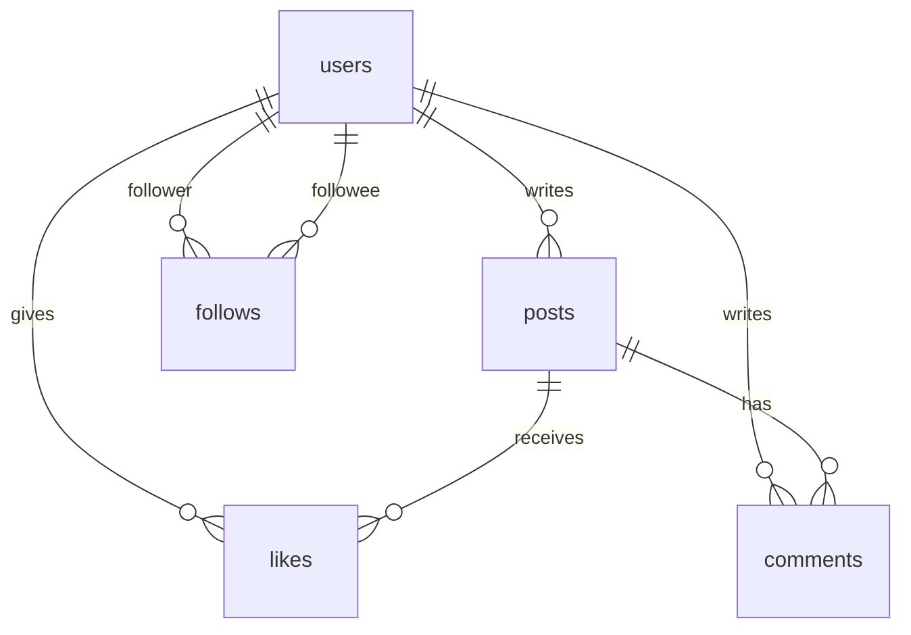

# Instagram-like MVP — Architecture

Status: Backend implemented (`backend/`); frontend not built yet
Implements: [REQUIREMENTS.md](REQUIREMENTS.md)

## 1. Decisions at a glance

| Concern | Choice |
|---|---|
| Shape | Modular monolith: one Spring Boot app with REST APIs, plus a separate React single-page app |
| Backend | Java 17, Spring Boot 3.5.x, Maven (wrapper included), Spring Web, Spring Data JPA (Hibernate) |
| Database | H2, file-based (`backend/data/instagram-mvp.mv.db`), schema managed by Flyway; Hibernate only validates it |
| Frontend | React 18 + TypeScript, Vite, React Router, TanStack Query |
| "Auth" | `X-Acting-User: <userId>` header, set from the user switcher (no real auth) |
| Seed / reset | Java `DemoDataService`: seeds on first start; visible **Reset Demo Data** button calls `POST /api/demo/reset` |
| Text limits | Post 1–500, comment 1–300 Unicode code points after trimming; enforced on the server |

How JPA is used: entities hold plain id columns (`authorId`, `postId`) rather
than `@ManyToOne` links, so no module reaches into another module's entities.
Batch reads use JPQL aggregate queries plus one native window-function query
(Section 8). The demo seed/reset uses `JdbcTemplate`, because it rewrites every
table at once and needs to restart identity counters.

## 2. Architecture diagram



## 3. Repository layout

```
/backend                      Spring Boot (Maven)
  src/main/java/com/example/insta/
    InstaApplication.java
    common/                   ApiError, ApiException, GlobalExceptionHandler, TextRules, TimeConfig (Clock)
      api/                    shared DTOs: UserSummary, PostView, CommentView, TextRequest
    user/                     User, UserRepository, UserService, UserController,
                              @ActingUser + ActingUserArgumentResolver
    follow/                   Follow, FollowRepository, FollowService, FollowController, FollowState
    post/                     Post, PostRepository, PostService, PostController (create only)
    engagement/               PostLike, Comment, their repositories, EngagementService,
                              EngagementController (like/unlike/comment), LikeState, PostStats
    feed/                     FeedService, PostViewAssembler, FeedController, Profile
    demo/                     DemoDataService (seed + reset), DemoController
  src/test/java/...           API tests per module (MockMvc), TextRulesTest, PersistenceTest
  src/main/resources/
    application.yml
    db/migration/V1__init.sql
/frontend                     Vite + React + TS
  src/api/                    client.ts, types.ts, endpoint functions
  src/context/                ActingUserContext.tsx
  src/pages/                  FeedPage, ProfilePage, PostDetailPage, NotFoundPage
  src/components/             see Section 7
/backend/data                 H2 files (git-ignored, created at runtime)
```

## 4. Backend modules

Each module is a Java package with a public service and a controller. Its
repositories (and, where possible, entities) are package-private, so other
modules can't call them. A module
uses another module only through that module's service. No cycles.

| Module | Owns tables | Responsibilities | Depends on |
|---|---|---|---|
| `common` | — | `ApiError` + `@RestControllerAdvice`, `ApiException`, `TextRules`, `Clock` bean, shared DTOs | — |
| `user` | `users` | List users, look up by id/username, `@ActingUser` header resolver (it needs the user lookup, so it lives here rather than in `common`) | — |
| `follow` | `follows` | Follow/unfollow (idempotent, no self-follow), followers/following lists, `followeeIds(userId)`, counts | `user` |
| `post` | `posts` | Create post (validate, trim, set author + time), `findByAuthors`, `findById`, `countByAuthor` | `user` |
| `engagement` | `likes`, `comments` | Like/unlike (idempotent), add comment, batch stats per post list | `user`, `post` |
| `feed` | — (read only) | Feed, a user's posts, post detail: combines posts + engagement into `PostView` | `user`, `follow`, `post`, `engagement` |
| `demo` | all (delete + insert) | Seed on first start, reset on request | runs SQL across all tables (`JdbcTemplate`) |

Note: to avoid a `user` ↔ `follow` cycle, the **profile** endpoint
(`GET /api/users/{username}`) lives in the `feed` module, which already
depends on both. `user` itself only exposes plain user data.

Write flow for any action:
1. The controller gets the acting user from `@ActingUser` (400 if missing or unknown).
2. The service validates input, checks the target exists (404), and writes.
3. The controller returns the updated state, so the client can refresh without another request.

## 5. Database schema

Flyway migration `V1__init.sql`; Hibernate runs with `ddl-auto: validate`, so a
mismatch between entities and schema fails at startup. Timestamps are stored as
UTC `TIMESTAMP(6) WITH TIME ZONE` and mapped to `java.time.Instant`. The server
truncates new timestamps to microseconds so what it returns matches what it stores.

```sql
CREATE TABLE users (
  id           VARCHAR(20)  PRIMARY KEY,          -- 'u1', 'u2', 'u3'
  username     VARCHAR(30)  NOT NULL UNIQUE,
  display_name VARCHAR(60)  NOT NULL,
  bio          VARCHAR(160)
);

CREATE TABLE posts (
  id         BIGINT GENERATED BY DEFAULT AS IDENTITY PRIMARY KEY,
  author_id  VARCHAR(20)   NOT NULL REFERENCES users(id),
  text       VARCHAR(2000) NOT NULL,              -- 500 code points enforced in app (see below)
  created_at TIMESTAMP(6) WITH TIME ZONE NOT NULL
);
CREATE INDEX idx_posts_author_created ON posts(author_id, created_at DESC, id DESC);

CREATE TABLE likes (
  post_id    BIGINT      NOT NULL REFERENCES posts(id),
  user_id    VARCHAR(20) NOT NULL REFERENCES users(id),
  created_at TIMESTAMP(6) WITH TIME ZONE NOT NULL,
  PRIMARY KEY (post_id, user_id)                  -- one like per user per post
);

CREATE TABLE comments (
  id         BIGINT GENERATED BY DEFAULT AS IDENTITY PRIMARY KEY,
  post_id    BIGINT        NOT NULL REFERENCES posts(id),
  author_id  VARCHAR(20)   NOT NULL REFERENCES users(id),
  text       VARCHAR(1200) NOT NULL,              -- 300 code points enforced in app
  created_at TIMESTAMP(6) WITH TIME ZONE NOT NULL
);
CREATE INDEX idx_comments_post_created ON comments(post_id, created_at, id);

CREATE TABLE follows (
  follower_id VARCHAR(20) NOT NULL REFERENCES users(id),
  followee_id VARCHAR(20) NOT NULL REFERENCES users(id),
  created_at  TIMESTAMP(6) WITH TIME ZONE NOT NULL,
  PRIMARY KEY (follower_id, followee_id),
  CONSTRAINT chk_no_self_follow CHECK (follower_id <> followee_id)
);
CREATE INDEX idx_follows_followee ON follows(followee_id);
```



Schema notes:
- **Length limits.** Java `String.length()` counts UTF-16 units, so one emoji counts as 2. `TextRules` trims, then checks `text.codePointCount(...)` against 500 / 300. The columns are wider than the limit so a valid emoji-heavy post never hits a database error.
- **Idempotency.** Like and follow check `existsById`, then insert with `saveAndFlush` (the entities implement `Persistable` with `isNew() = true`, so JPA inserts instead of merging). If two identical requests race, the primary key rejects the second insert; the service catches `DataIntegrityViolationException`, confirms the row now exists, and treats it as success. Unlike and unfollow are a JPQL `DELETE` that may affect 0 rows.
- **Entity naming.** The like entity is `PostLike` because `LIKE` is a JPQL keyword.
- **Self-follow** is rejected in `FollowService` (400) and blocked again by the `CHECK` constraint.
- **IDs.** Seed posts p1–p3 become post ids 1–3, inserted in that order. Ids increase with insert order, so they work as the tie-breaker for feed ordering.

`application.yml` (key settings):

```yaml
spring:
  datasource:
    url: jdbc:h2:file:./data/instagram-mvp   # relative to backend/
    username: sa
    password: ""
  flyway.enabled: true
  jpa:
    open-in-view: false
    hibernate.ddl-auto: validate
  h2.console.enabled: true     # http://localhost:8080/h2-console (dev only)
```

## 6. REST API

Base path `/api`, JSON. Every request except `GET /api/users` and
`POST /api/demo/reset` must send `X-Acting-User: <userId>`. Errors use one
shape (`field` is omitted when it doesn't apply):

```json
{ "status": 400, "code": "VALIDATION_ERROR", "message": "Post cannot be empty.", "field": "text" }
```

| Code | When |
|---|---|
| 400 `VALIDATION_ERROR` | Empty or too-long text, self-follow, missing or malformed JSON body |
| 400 `INVALID_ACTING_USER` | Header missing or names an unknown user (checked before anything else) |
| 404 `NOT_FOUND` | Unknown post or target user, non-numeric post id, unknown route |
| 405 `METHOD_NOT_ALLOWED` | Wrong HTTP method for a route |
| 415 `UNSUPPORTED_MEDIA_TYPE` | Body sent without `Content-Type: application/json` |
| 500 `INTERNAL_ERROR` | Anything unexpected; generic message, no stack trace |

### Endpoints

| Method | Path | Body | Success | Module |
|---|---|---|---|---|
| GET | `/users` | — | 200 `UserSummary[]` | user |
| GET | `/users/{username}` | — | 200 `Profile` | feed |
| GET | `/users/{username}/posts` | — | 200 `PostView[]` (newest first) | feed |
| GET | `/users/{username}/followers` | — | 200 `UserSummary[]` | follow |
| GET | `/users/{username}/following` | — | 200 `UserSummary[]` | follow |
| PUT | `/users/{username}/follow` | — | 200 `FollowState` | follow |
| DELETE | `/users/{username}/follow` | — | 200 `FollowState` | follow |
| GET | `/feed` | — | 200 `PostView[]` | feed |
| POST | `/posts` | `{ "text": string }` | 201 `PostView` (0 likes, 0 comments) | post |
| GET | `/posts/{id}` | — | 200 `PostView` with **all** comments | feed |
| PUT | `/posts/{id}/like` | — | 200 `LikeState` | engagement |
| DELETE | `/posts/{id}/like` | — | 200 `LikeState` | engagement |
| POST | `/posts/{id}/comments` | `{ "text": string }` | 201 `Comment` | engagement |
| POST | `/demo/reset` | — | 204 | demo |

### Response types

```ts
type UserSummary = { id: string; username: string; displayName: string };
type Profile     = UserSummary & { bio: string | null; postCount: number;
                   followerCount: number; followingCount: number; followedByMe: boolean };
type FollowState = { followedByMe: boolean; followerCount: number; followingCount: number }; // target's counts
type LikeState   = { postId: number; likedByMe: boolean; likeCount: number };
type Comment     = { id: number; postId: number; author: UserSummary; text: string; createdAt: string };
type PostView    = { id: number; author: UserSummary; text: string; createdAt: string; // ISO-8601 UTC
                     likeCount: number; likedByMe: boolean; commentCount: number;
                     comments: Comment[] };  // feed/profile: 2 most recent, oldest first; detail: all
```

## 7. Frontend

**Routes:** `/` feed, `/users/:username` profile (followers and following as
tabs), `/posts/:id` post detail, `*` not found.

**Component tree**

```
App
└─ ActingUserProvider            reads/writes localStorage; falls back to 'u1' (alice) if invalid
   └─ QueryClientProvider
      └─ AppLayout
         ├─ Header: UserSwitcher, ResetDemoButton
         ├─ Sidebar: UserList (links to the 3 profiles)
         └─ <Routes>
            ├─ FeedPage:       PostComposer, PostCard*, EmptyFeed
            ├─ ProfilePage:    ProfileHeader (FollowButton), PostCard*, FollowList
            ├─ PostDetailPage: PostCard (all comments)
            └─ NotFoundPage
PostCard = author link, text (pre-wrap, plain text), RelativeTime, LikeButton, CommentList, CommentForm
```

**Interaction rules**
- **API client:** `client.ts` wraps `fetch`. It reads the acting user **when the call starts** and sets the header, so a request already in flight finishes as the user who started it (E22).
- **Cache keys** include the acting user id, for example `['feed', actingUserId]`. Switching user shows that user's data without manual cache clearing.
- **After a successful write** (post, like, comment, follow), invalidate `feed`, `userPosts`, `post` and `profile` queries so every visible view updates (FR-5.6). At MVP size, invalidating these broadly is simpler than precise cache updates.
- **Submit buttons** (post, comment, like, follow) are disabled while their request is in flight, which prevents double submits (E9, E10).
- **Character counters** count code points (`[...text.trim()].length`), matching the server.
- **Text rendering:** user text goes through React's default escaping only. No `dangerouslySetInnerHTML` (E6). CSS `white-space: pre-wrap; overflow-wrap: anywhere` covers E7 and E8.
- **Reset Demo Data:** the button asks for confirmation, calls `POST /api/demo/reset`, then calls `queryClient.invalidateQueries()` on everything. The acting user is kept, since the three users always exist.

## 8. Feed retrieval logic

`FeedService.feed(me)` runs a fixed number of queries (six), however many posts there are:

1. **Author set:** `authorIds = {me} ∪ followService.followeeIds(me)`
2. **Posts** (`post` module), a Spring Data derived query:
   `findByAuthorIdInOrderByCreatedAtDescIdDesc(authorIds)`
3. **Engagement for those posts** (`engagement` module, called with all `postIds` at once):
   ```sql
   -- JPQL: like counts and comment counts, grouped
   select new PostCount(l.postId, count(l)) from PostLike l where l.postId in :postIds group by l.postId
   select new PostCount(c.postId, count(c)) from Comment c  where c.postId in :postIds group by c.postId
   -- JPQL: which of these the acting user liked
   select l.postId from PostLike l where l.userId = :me and l.postId in :postIds

   -- native SQL: the 2 most recent comments per post
   SELECT id, post_id, author_id, text, created_at FROM (
     SELECT c.*, ROW_NUMBER() OVER (PARTITION BY c.post_id ORDER BY c.created_at DESC, c.id DESC) AS rn
     FROM comments c WHERE c.post_id IN (:postIds)
   ) ranked WHERE rn <= 2;
   ```
4. **Assemble** (`PostViewAssembler`): join posts with stats and authors (one `userService.summariesById` call each for post and comment authors), and sort each post's preview comments oldest first.

Why this satisfies the requirements:
- **FR-5.1:** only posts by me or people I follow right now, because follows are read at request time.
- **FR-5.2:** newest first, ties broken by `id DESC`, so the order is stable.
- **FR-5.4:** following someone includes all their existing posts; unfollowing removes them on the next fetch.
- **E18:** likes and comments are never touched by unfollow.

The same assembler serves `GET /users/{username}/posts` (author set = that
user) and `GET /posts/{id}` (one post, all comments). At the MVP scale
(about 1,000 posts, 3 users) there's no pagination. If needed later, add keyset
pagination on `(created_at, id)` using the existing index.

## 9. Seed data and reset

`DemoDataService` holds the seed from REQUIREMENTS.md Section 4 in code.

- **On startup** (`ApplicationRunner`): if `users` is empty, seed. Existing data is left alone, which keeps it across restarts (NFR-1).
- **Reset:**
  1. Restart identity counters: `ALTER TABLE posts ALTER COLUMN id RESTART WITH 1`, and the same for `comments`. H2 commits implicitly on DDL, so this runs first, outside the transaction.
  2. In one transaction: `DELETE` in dependency order (comments, likes, follows, posts, users), then insert the seed with `T = clock.instant()`: p1 at T−3h, p2 at T−2h, p3 at T−1h, the seed follows, and the likes and comment timed after their posts.
  3. Seed posts therefore always get ids 1–3 (p1–p3).
- Known limit: a post created by another request in the instant between steps 1 and 2 could hit a duplicate id and fail. Acceptable for a single-user local demo.
- Time comes from an injected `Clock`, so tests can fix T.

## 10. Running locally

| Step | Command | URL |
|---|---|---|
| Backend | `cd backend && ./mvnw spring-boot:run` | http://localhost:8080 |
| Frontend | `cd frontend && npm install && npm run dev` | http://localhost:5173 |

Vite proxies `/api` to `localhost:8080`, so the browser makes no
cross-origin requests and no CORS setup is needed. Deleting `backend/data/`
starts a fresh database that is seeded on the next start. Run the backend
tests with `cd backend && ./mvnw test`.

## 11. Testing approach

- **Backend:** `@SpringBootTest` + MockMvc against an in-memory H2 (`jdbc:h2:mem:`, `test` profile), with a settable `MutableClock`. Each test starts from a demo reset. API tests per module cover the backend side of AC-1 to AC-7 and the edge cases; `TextRulesTest` covers trimming, 500/501 and emoji counting; `PersistenceTest` restarts the app on a temporary H2 file to prove data survives (AC-6.1); a concurrency test fires 8 simultaneous identical likes and checks one row is stored.
- **Frontend:** Vitest + React Testing Library for PostComposer limits, LikeButton/FollowButton toggles and disabled-while-pending, and EmptyFeed.
- **Manual smoke test:** reset, switch through alice/bob/carol, and check feeds match AC-5.1 to AC-5.3.
