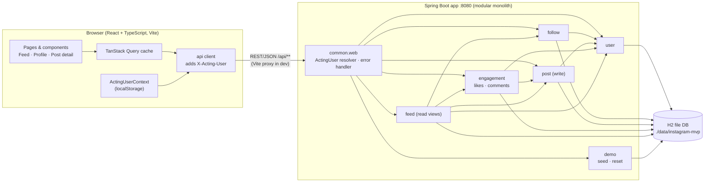
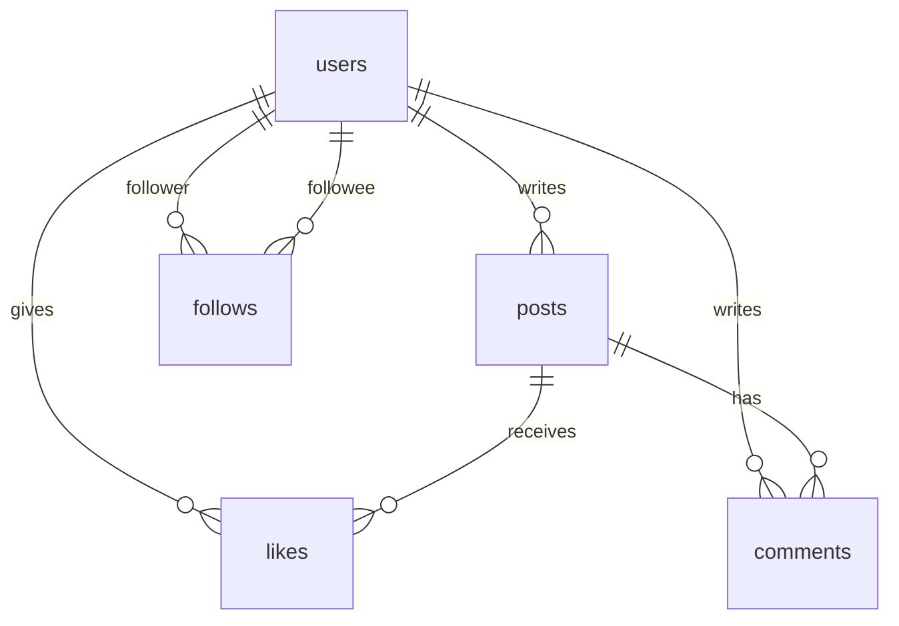

# Instagram-like MVP — Architecture

Status: Draft (design only; no application code yet)
Implements: [REQUIREMENTS.md](REQUIREMENTS.md)

## 1. Decisions at a glance

| Concern | Choice |
|---|---|
| Shape | Modular monolith: one Spring Boot app with REST APIs, plus a separate React single-page app |
| Backend | Java 17, Spring Boot 3.3.x, Maven, Spring Web, Spring JDBC (`JdbcClient`), Bean Validation |
| Database | H2, file-based (`./data/instagram-mvp.mv.db`), schema managed by Flyway |
| Frontend | React 18 + TypeScript, Vite, React Router, TanStack Query |
| "Auth" | `X-Acting-User: <userId>` header, set from the user switcher (no real auth) |
| Seed / reset | Java `DemoDataService`: seeds on first start; visible **Reset Demo Data** button calls `POST /api/demo/reset` |
| Text limits | Post 1–500, comment 1–300 Unicode code points after trimming; enforced on the server |

Why Spring JDBC rather than JPA: the schema is small and the feed is a read query
with counts and ordering, which is clearer as explicit SQL. Idempotent likes and
follows rely on primary-key constraints, which plain SQL handles directly.

## 2. Architecture diagram



## 3. Repository layout

```
/backend                      Spring Boot (Maven)
  src/main/java/com/example/insta/
    InstaApplication.java
    common/                   ActingUser resolver, ApiError, exceptions, TextRules, Clock bean,
                              shared DTOs (UserSummary, PostView, Comment)
    user/                     UserController, UserService, UserRepository
    follow/                   FollowController, FollowService, FollowRepository
    post/                     PostController (create), PostService, PostRepository
    engagement/               LikeController, CommentController, EngagementService, Like/CommentRepository
    feed/                     FeedController, PostQueryController, FeedService, PostViewAssembler
    demo/                     DemoController, DemoDataService, DemoSeed
  src/main/resources/
    application.yml
    db/migration/V1__init.sql
/frontend                     Vite + React + TS
  src/api/                    client.ts, types.ts, endpoint functions
  src/context/                ActingUserContext.tsx
  src/pages/                  FeedPage, ProfilePage, PostDetailPage, NotFoundPage
  src/components/             see Section 7
/data                         H2 files (git-ignored, created at runtime)
```

## 4. Backend modules

Each module is a Java package with a public service and a controller. Its
repositories are package-private, so other modules can't call them. A module
uses another module only through that module's service. No cycles.

| Module | Owns tables | Responsibilities | Depends on |
|---|---|---|---|
| `common` | — | `@ActingUser` argument resolver, `ApiError` + `@RestControllerAdvice`, `NotFoundException`/`ValidationException`, `TextRules`, `Clock` bean | — |
| `user` | `users` | List users, look up by id/username | — |
| `follow` | `follows` | Follow/unfollow (idempotent, no self-follow), followers/following lists, `followeeIds(userId)`, counts | `user` |
| `post` | `posts` | Create post (validate, trim, set author + time), `findByAuthors`, `findById`, `countByAuthor` | `user` |
| `engagement` | `likes`, `comments` | Like/unlike (idempotent), add comment, batch stats per post list | `user`, `post` |
| `feed` | — (read only) | Feed, a user's posts, post detail: combines posts + engagement into `PostView` | `user`, `follow`, `post`, `engagement` |
| `demo` | all (delete + insert) | Seed on first start, reset on request | runs SQL across all tables in one transaction |

Note: to avoid a `user` ↔ `follow` cycle, the **profile** endpoint
(`GET /api/users/{username}`) lives in the `feed` module, which already
depends on both. `user` itself only exposes plain user data.

Write flow for any action:
1. The controller gets the acting user from `@ActingUser` (400 if missing or unknown).
2. The service validates input, checks the target exists (404), and writes.
3. The controller returns the updated state, so the client can refresh without another request.

## 5. Database schema

Flyway migration `V1__init.sql`. Timestamps are stored as UTC
`TIMESTAMP WITH TIME ZONE` and mapped to `java.time.Instant`.

```sql
CREATE TABLE users (
  id           VARCHAR(20)  PRIMARY KEY,          -- 'u1', 'u2', 'u3'
  username     VARCHAR(30)  NOT NULL UNIQUE,
  display_name VARCHAR(60)  NOT NULL,
  bio          VARCHAR(160)
);

CREATE TABLE posts (
  id         BIGINT GENERATED BY DEFAULT AS IDENTITY PRIMARY KEY,
  author_id  VARCHAR(20)   NOT NULL REFERENCES users(id),
  text       VARCHAR(2000) NOT NULL,              -- 500 code points enforced in app (see below)
  created_at TIMESTAMP WITH TIME ZONE NOT NULL
);
CREATE INDEX idx_posts_author_created ON posts(author_id, created_at DESC, id DESC);

CREATE TABLE likes (
  post_id    BIGINT      NOT NULL REFERENCES posts(id),
  user_id    VARCHAR(20) NOT NULL REFERENCES users(id),
  created_at TIMESTAMP WITH TIME ZONE NOT NULL,
  PRIMARY KEY (post_id, user_id)                  -- one like per user per post
);

CREATE TABLE comments (
  id         BIGINT GENERATED BY DEFAULT AS IDENTITY PRIMARY KEY,
  post_id    BIGINT        NOT NULL REFERENCES posts(id),
  author_id  VARCHAR(20)   NOT NULL REFERENCES users(id),
  text       VARCHAR(1200) NOT NULL,              -- 300 code points enforced in app
  created_at TIMESTAMP WITH TIME ZONE NOT NULL
);
CREATE INDEX idx_comments_post_created ON comments(post_id, created_at, id);

CREATE TABLE follows (
  follower_id VARCHAR(20) NOT NULL REFERENCES users(id),
  followee_id VARCHAR(20) NOT NULL REFERENCES users(id),
  created_at  TIMESTAMP WITH TIME ZONE NOT NULL,
  PRIMARY KEY (follower_id, followee_id),
  CONSTRAINT chk_no_self_follow CHECK (follower_id <> followee_id)
);
CREATE INDEX idx_follows_followee ON follows(followee_id);
```



Schema notes:
- **Length limits.** Java `String.length()` counts UTF-16 units, so one emoji counts as 2. `TextRules` trims, then checks `text.codePointCount(...)` against 500 / 300. The columns are wider than the limit so a valid emoji-heavy post never hits a database error.
- **Idempotency.** Like and follow do a plain `INSERT`. A `DuplicateKeyException` is caught and treated as success, which is also safe when two identical requests race. Unlike and unfollow are a `DELETE` that may affect 0 rows.
- **Self-follow** is rejected in `FollowService` (400) and blocked again by the `CHECK` constraint.
- **IDs.** Seed posts p1–p3 become post ids 1–3, inserted in that order. Ids increase with insert order, so they work as the tie-breaker for feed ordering.

`application.yml` (key settings):

```yaml
spring:
  datasource:
    url: jdbc:h2:file:./data/instagram-mvp
    username: sa
    password: ""
  flyway.enabled: true
  h2.console.enabled: true     # http://localhost:8080/h2-console (dev only)
```

## 6. REST API

Base path `/api`, JSON. Every request except `GET /api/users` must send
`X-Acting-User: <userId>`. Errors use one shape:

```json
{ "status": 400, "code": "VALIDATION_ERROR", "message": "Post cannot be empty.", "field": "text" }
```

| Code | When |
|---|---|
| 400 `VALIDATION_ERROR` | Empty or too-long text, self-follow |
| 400 `INVALID_ACTING_USER` | Header missing or names an unknown user |
| 404 `NOT_FOUND` | Unknown post or target user |

### Endpoints

| Method | Path | Body | Success | Module |
|---|---|---|---|---|
| GET | `/users` | — | 200 `UserSummary[]` | user |
| GET | `/users/{username}` | — | 200 `Profile` | feed |
| GET | `/users/{username}/posts` | — | 200 `PostView[]` (newest first) | feed |
| GET | `/users/{username}/followers` | — | 200 `UserSummary[]` | follow |
| GET | `/users/{username}/following` | — | 200 `UserSummary[]` | follow |
| PUT | `/users/{username}/follow` | — | 200 `FollowState` | follow |
| DELETE | `/users/{username}/follow` | — | 200 `FollowState` | follow |
| GET | `/feed` | — | 200 `PostView[]` | feed |
| POST | `/posts` | `{ "text": string }` | 201 `PostView` (0 likes, 0 comments) | post |
| GET | `/posts/{id}` | — | 200 `PostView` with **all** comments | feed |
| PUT | `/posts/{id}/like` | — | 200 `LikeState` | engagement |
| DELETE | `/posts/{id}/like` | — | 200 `LikeState` | engagement |
| POST | `/posts/{id}/comments` | `{ "text": string }` | 201 `Comment` | engagement |
| POST | `/demo/reset` | — | 204 | demo |

### Response types

```ts
type UserSummary = { id: string; username: string; displayName: string };
type Profile     = UserSummary & { bio: string | null; postCount: number;
                   followerCount: number; followingCount: number; followedByMe: boolean };
type FollowState = { followedByMe: boolean; followerCount: number; followingCount: number }; // target's counts
type LikeState   = { postId: number; likedByMe: boolean; likeCount: number };
type Comment     = { id: number; postId: number; author: UserSummary; text: string; createdAt: string };
type PostView    = { id: number; author: UserSummary; text: string; createdAt: string; // ISO-8601 UTC
                     likeCount: number; likedByMe: boolean; commentCount: number;
                     comments: Comment[] };  // feed/profile: 2 most recent, oldest first; detail: all
```

## 7. Frontend

**Routes:** `/` feed, `/users/:username` profile (followers and following as
tabs), `/posts/:id` post detail, `*` not found.

**Component tree**

```
App
└─ ActingUserProvider            reads/writes localStorage; falls back to 'u1' (alice) if invalid
   └─ QueryClientProvider
      └─ AppLayout
         ├─ Header: UserSwitcher, ResetDemoButton
         ├─ Sidebar: UserList (links to the 3 profiles)
         └─ <Routes>
            ├─ FeedPage:       PostComposer, PostCard*, EmptyFeed
            ├─ ProfilePage:    ProfileHeader (FollowButton), PostCard*, FollowList
            ├─ PostDetailPage: PostCard (all comments)
            └─ NotFoundPage
PostCard = author link, text (pre-wrap, plain text), RelativeTime, LikeButton, CommentList, CommentForm
```

**Interaction rules**
- **API client:** `client.ts` wraps `fetch`. It reads the acting user **when the call starts** and sets the header, so a request already in flight finishes as the user who started it (E22).
- **Cache keys** include the acting user id, for example `['feed', actingUserId]`. Switching user shows that user's data without manual cache clearing.
- **After a successful write** (post, like, comment, follow), invalidate `feed`, `userPosts`, `post` and `profile` queries so every visible view updates (FR-5.6). At MVP size, invalidating these broadly is simpler than precise cache updates.
- **Submit buttons** (post, comment, like, follow) are disabled while their request is in flight, which prevents double submits (E9, E10).
- **Character counters** count code points (`[...text.trim()].length`), matching the server.
- **Text rendering:** user text goes through React's default escaping only. No `dangerouslySetInnerHTML` (E6). CSS `white-space: pre-wrap; overflow-wrap: anywhere` covers E7 and E8.
- **Reset Demo Data:** the button asks for confirmation, calls `POST /api/demo/reset`, then calls `queryClient.invalidateQueries()` on everything. The acting user is kept, since the three users always exist.

## 8. Feed retrieval logic

`FeedService.getFeed(me)` runs a fixed 3 queries, however many posts there are:

1. **Author set:** `authorIds = {me} ∪ followService.followeeIds(me)`
2. **Posts** (`post` module):
   ```sql
   SELECT p.id, p.author_id, p.text, p.created_at
   FROM posts p
   WHERE p.author_id IN (:authorIds)
   ORDER BY p.created_at DESC, p.id DESC
   ```
3. **Engagement for those posts** (`engagement` module, one call with all `postIds`). Internally this is up to three small batch queries:
   ```sql
   -- counts + likedByMe
   SELECT p.id,
          (SELECT COUNT(*) FROM likes l    WHERE l.post_id = p.id) AS like_count,
          (SELECT COUNT(*) FROM comments c WHERE c.post_id = p.id) AS comment_count,
          EXISTS (SELECT 1 FROM likes l WHERE l.post_id = p.id AND l.user_id = :me) AS liked_by_me
   FROM posts p WHERE p.id IN (:postIds);

   -- 2 most recent comments per post
   SELECT * FROM (
     SELECT c.*, ROW_NUMBER() OVER (PARTITION BY c.post_id ORDER BY c.created_at DESC, c.id DESC) AS rn
     FROM comments c WHERE c.post_id IN (:postIds)
   ) WHERE rn <= 2;
   ```
4. **Assemble** (`PostViewAssembler`): join posts with stats and comment authors (users come from one `userService.findByIds` call), and sort each post's preview comments oldest first.

Why this satisfies the requirements:
- **FR-5.1:** only posts by me or people I follow right now, because follows are read at request time.
- **FR-5.2:** newest first, ties broken by `id DESC`, so the order is stable.
- **FR-5.4:** following someone includes all their existing posts; unfollowing removes them on the next fetch.
- **E18:** likes and comments are never touched by unfollow.

The same assembler serves `GET /users/{username}/posts` (author set = that
user) and `GET /posts/{id}` (one post, all comments). At the MVP scale
(about 1,000 posts, 3 users) there's no pagination. If needed later, add keyset
pagination on `(created_at, id)` using the existing index.

## 9. Seed data and reset

`DemoDataService` holds the seed from REQUIREMENTS.md Section 4 as Java constants.

- **On startup** (`ApplicationRunner`): if `users` is empty, seed. Existing data is left alone, which keeps it across restarts (NFR-1).
- **Reset** (`@Transactional`):
  1. `DELETE` in dependency order: comments, likes, follows, posts, users.
  2. Restart identity counters: `ALTER TABLE posts ALTER COLUMN id RESTART WITH 1`, and the same for `comments`.
  3. Insert the seed with `T = clock.instant()`: p1 at T−3h, p2 at T−2h, p3 at T−1h, plus the seed follows, likes and comment (likes and the comment get timestamps after their post).
- Time comes from an injected `Clock`, so tests can fix T.

## 10. Running locally

| Step | Command | URL |
|---|---|---|
| Backend | `cd backend && ./mvnw spring-boot:run` | http://localhost:8080 |
| Frontend | `cd frontend && npm install && npm run dev` | http://localhost:5173 |

Vite proxies `/api` to `localhost:8080`, so the browser makes no
cross-origin requests and no CORS setup is needed. Deleting `./data/`
starts a fresh database that is seeded on the next start.

## 11. Testing approach

- **Backend:** `@SpringBootTest` + MockMvc against an in-memory H2 (`jdbc:h2:mem:`, test profile), with a fixed `Clock`. Acceptance criteria AC-0 to AC-7 map to API tests, run after a reset. Unit tests cover `TextRules` (trimming, 500/501, emoji counting).
- **Frontend:** Vitest + React Testing Library for PostComposer limits, LikeButton/FollowButton toggles and disabled-while-pending, and EmptyFeed.
- **Manual smoke test:** reset, switch through alice/bob/carol, and check feeds match AC-5.1 to AC-5.3.
