# Instaclone: Instagram-like social MVP

A small, text-only social app modeled on Instagram. Users write short posts, like and
comment on them, and follow each other. Each user gets a chronological feed. It's a
Spring Boot + React modular monolith that runs locally, with three demo users and no
login.

It was built in stages with Claude Code: requirements, then architecture, backend,
frontend, browser tests and submission prep. The exact prompts are in
[PROMPTS.md](PROMPTS.md).

| Document | Contents |
|---|---|
| [REQUIREMENTS.md](REQUIREMENTS.md) | Functional requirements, edge cases (E1–E28), acceptance criteria (AC-0 to AC-7) |
| [ARCHITECTURE.md](ARCHITECTURE.md) | Modules, database schema, REST API, feed query logic, diagrams |
| [PROMPTS.md](PROMPTS.md) | Every prompt used, verbatim and in order |

## Demo recording

https://github.com/user-attachments/assets/9f5e5099-6262-4dbe-a53c-1beb5a6f8349

A real Chromium session recorded with Playwright against the running backend and
frontend, using demo data only. In order, it shows:

1. The home feed with the seeded posts.
2. Switching between alice, bob and carol, whose feeds differ.
3. alice creating a post, which appears at the top of her feed.
4. bob liking and commenting on that post.
5. alice following carol, and carol's older post appearing in her feed.
6. A page refresh, with everything still there because it's stored on the backend.
7. The Reset Demo Data confirmation, and the reset back to the original data.

Playwright's video doesn't capture the mouse pointer, so a small cursor overlay follows
the real mouse events. A caption at the bottom names each step. Everything else is the
live app. The brief white flash at 0:48 is the real page reload. The player above is
hosted by GitHub; the same file is kept in `docs/demo/`.

## Features

- **Demo users instead of login.** alice, bob and carol are seeded. An "Acting as" menu
  picks who you are, and the choice is remembered across reloads.
- **Text posts.** 1–500 characters after trimming, with emoji counted as one
  character. Line breaks are kept and HTML is shown as plain text.
- **Likes.** Like and unlike any post, including your own. A like can never be counted
  twice.
- **Comments.** 1–300 characters. The feed shows the two newest comments with a
  "View all N comments" link, and the post page shows all of them.
- **Follow and unfollow.** Following is one way, and you can't follow yourself. Profiles
  show post, follower and following counts, with Posts / Followers / Following tabs.
- **Chronological feed.** Your posts plus posts from people you follow, newest first.
  Following someone also brings in their older posts.
- **Reset Demo Data button**, with a confirmation dialog, restores the original data.
- **Polish.** Loading, error-with-retry and empty states; not-found pages; client-side
  checks that match the server's rules; keyboard and screen-reader support; a mobile
  layout; dark mode.

## Technology stack

| Layer | Technology |
|---|---|
| Backend | Java 17, Spring Boot 3.5.7 (Web, Data JPA / Hibernate), Maven wrapper |
| Database | H2 in file mode, schema managed by Flyway (Hibernate only validates it) |
| Frontend | React 18.3, TypeScript 5.6, Vite 5.4, React Router 6, TanStack Query 5 |
| Testing | JUnit 5 + MockMvc (backend), Vitest + Testing Library (frontend), Playwright 1.63 (browser) |
| Tooling | ESLint 9, `tsc` type checking |

## Architecture

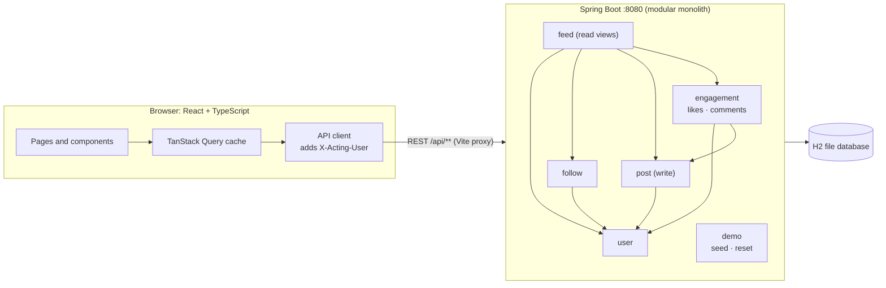

- **Backend modules** are Java packages (`user`, `follow`, `post`, `engagement`, `feed`,
  `demo`, plus shared `common`). Each exposes a public service. Repositories are
  package-private, so modules only talk to each other through services, and the
  dependencies have no cycles.
- **Writes and reads are split.** `post` and `engagement` handle writes. `feed` builds
  every post view (feed, profile posts, post detail) from batch queries, so a feed page
  takes a fixed number of database queries however many posts it shows.
- **The frontend** keys every cached query by the acting user, so switching users never
  shows another user's like or follow state. After any change, it refetches the affected
  views.

Full details, including the schema, all 14 endpoints, the error format and the feed
queries, are in [ARCHITECTURE.md](ARCHITECTURE.md).

## Key engineering decisions and tradeoffs

| Decision | Why | Tradeoff |
|---|---|---|
| An `X-Acting-User` header instead of authentication | Login is out of scope, and a header keeps every endpoint realistic | The server trusts the header, so this is not secure; it's for demos only |
| Modular monolith with package-private repositories | Clear boundaries without running separate services | Boundaries are enforced by visibility and convention, not by build modules |
| JPA entities hold plain ID columns, not `@ManyToOne` links | Stops modules reaching into each other's entities | Joins happen in services and batch queries, not through entity navigation |
| Database keys make likes and follows unique; repeating a request changes nothing | Holds even when two identical requests race (there's a test that fires 8 at once) | A race logs one harmless duplicate-key error from Hibernate |
| Text limits counted in Unicode code points, on both client and server | An emoji counts as one character, as users expect | Columns are wider than the limits; the application enforces them |
| Feed read model built from batch queries | No query-per-post problem; ordering is stable (newest first, then by ID) | No pagination yet, since the MVP targets about 1,000 posts |
| Refetch views after every change instead of updating the cache by hand | Simple, and it can't go stale | A few extra requests per action, which is fine at this size |
| Buttons are disabled while their request is in flight | Prevents double posts and double likes | Rapid extra clicks are ignored rather than queued (see edge case E10) |
| Flyway owns the schema; Hibernate only validates it | Explicit, reviewable SQL, and a mismatch fails at startup | Every schema change needs a migration |
| Vite proxies `/api` to the backend | One origin in the browser, so no CORS setup | Runs as two processes in development |

## Run it locally

Prerequisites: **Java 17+** and **Node 18+**. On macOS: `brew install openjdk@17 node`.

**1. Backend.** From `backend/` (the first run downloads Maven and dependencies):

```bash
./mvnw spring-boot:run
```

The API runs at http://localhost:8080 and stores data in `backend/data/`. On first start
it seeds alice (`u1`), bob (`u2`) and carol (`u3`) with sample posts, likes, follows and
a comment. Deleting `backend/data/` starts fresh.

**2. Frontend.** From `frontend/`, in a second terminal:

```bash
npm install
```

```bash
npm run dev
```

Open http://localhost:5173. Use **Acting as** to switch users, and **Reset Demo Data** to
start over.

**Calling the API directly:** send `X-Acting-User: u1` (or `u2`, `u3`) on every request
except `GET /api/users` and `POST /api/demo/reset`. For example:

```bash
curl -H 'X-Acting-User: u2' http://localhost:8080/api/feed
```

## Automated tests

| Suite | Command (directory) | What it covers |
|---|---|---|
| Backend | `./mvnw test` (`backend/`) | API tests per module (MockMvc, in-memory H2), text rules, persistence across a restart, concurrent duplicate likes |
| Frontend unit and component | `npm test` (`frontend/`) | Text and time helpers, API client errors, the whole app rendered against a fake API |
| Browser (end to end) | `npm run test:e2e` (`frontend/`) | Real backend + Vite + Chromium: acceptance criteria through the UI, keyboard, mobile layout |
| Lint and types | `npm run lint`, `npm run typecheck` (`frontend/`) | ESLint and `tsc` |
| Production build | `npm run build` (`frontend/`) | Type check plus Vite build |
| Demo video | `npm run demo:record`, then `npm run demo:mp4` (`frontend/`) | Re-records the walkthrough; the conversion needs `ffmpeg` with `libx264` |

The browser tests start the backend and Vite themselves. The backend gets its own
database under `backend/target/e2e-data/`, so your `backend/data/` is untouched. If
something already runs on :8080 or :5173 it is reused, and its data is reset. Install
the browser once per machine first:

```bash
npx playwright install chromium
```

Every browser test starts from freshly reset demo data. It fails on any browser console
error or any API error the test didn't expect. `npm run screenshots` regenerates
`docs/screenshots/`.

### Verified results

Last full run: 2026-10-29, in a Linux cloud container (JDK 21 compiling for Java 17,
Node 22, headless Chromium).

| Check | Result |
|---|---|
| Backend tests | **56 passed**, 0 failed |
| Frontend unit and component tests | **29 passed**, 0 failed |
| Browser tests | **14 passed**, 0 failed |
| ESLint, `tsc`, production build | Clean |

## Screenshots

Captured from the running app by `npm run screenshots`, using demo data only.

| | |
|---|---|
| **Feed** (alice) | **Creating a post** |
| 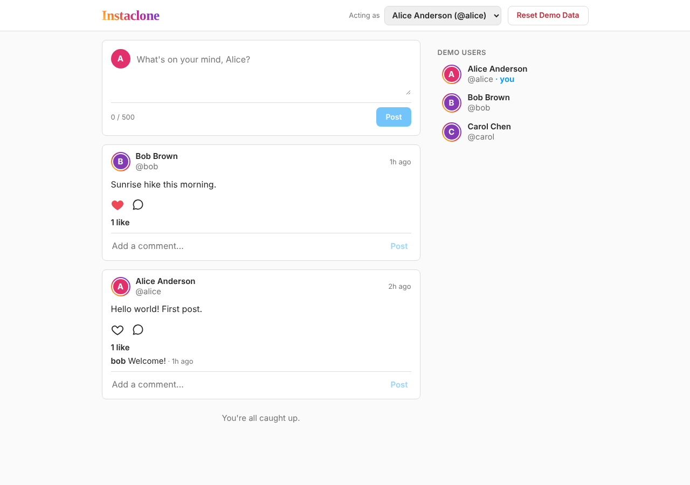 | 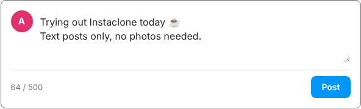 |
| **New post at the top of the feed** | **Likes and comments** (bob liked and commented) |
| 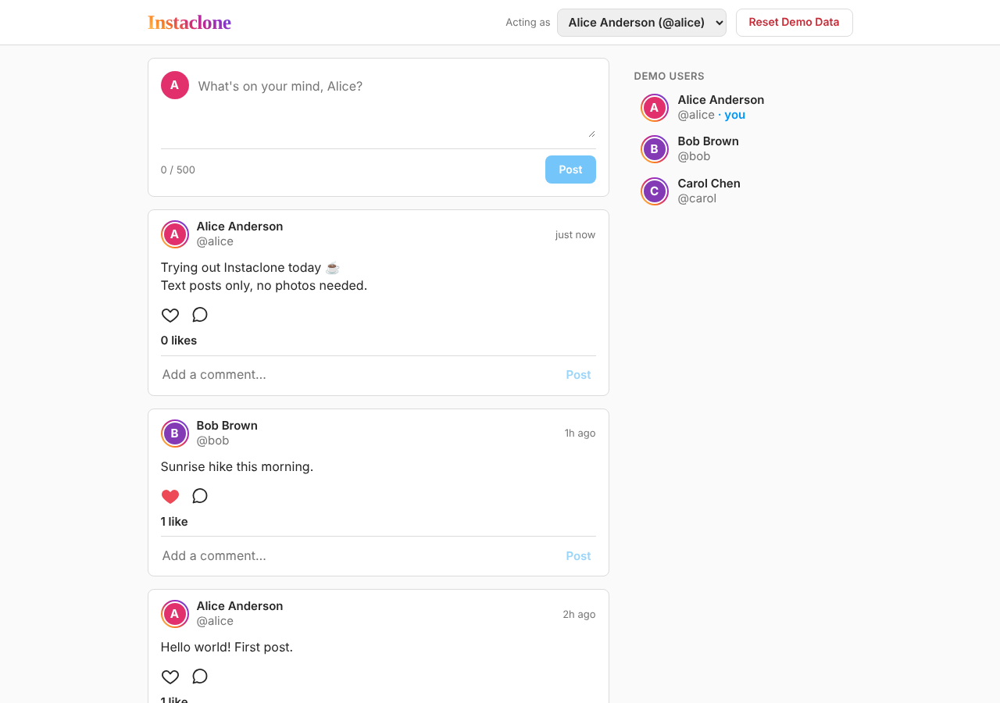 | 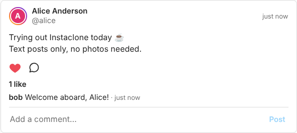 |
| **Profile** (carol, not followed) | **After following** (followers tab) |
| 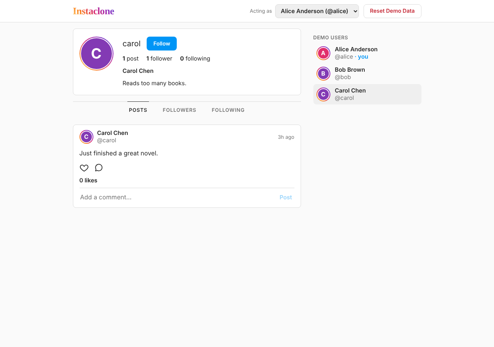 | 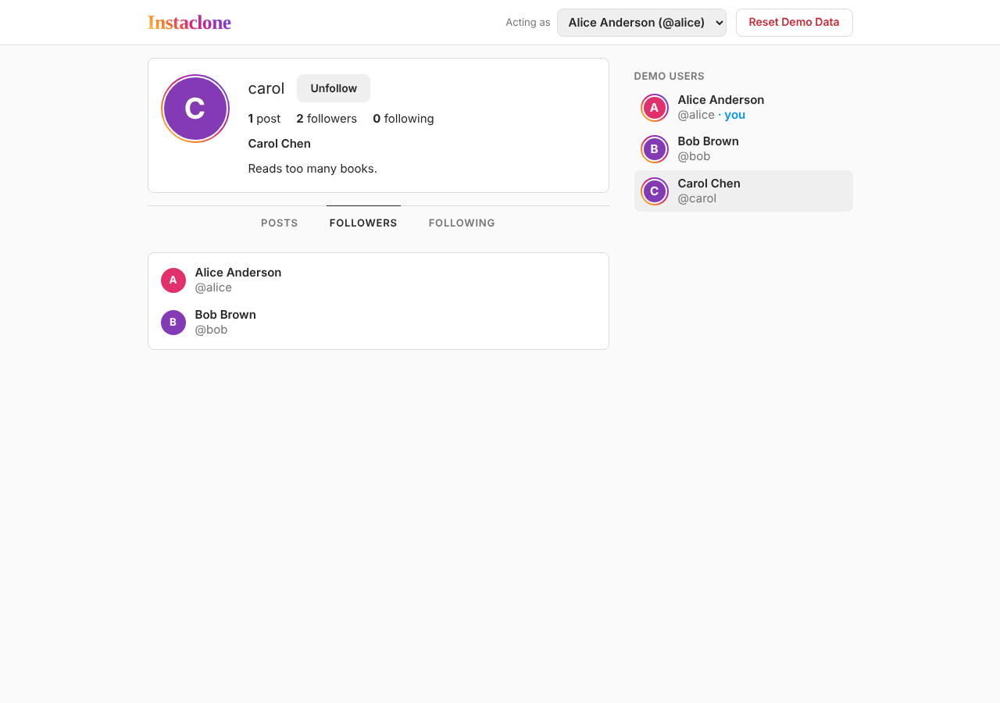 |
| **Feed after following carol** | **Reset Demo Data confirmation** |
| 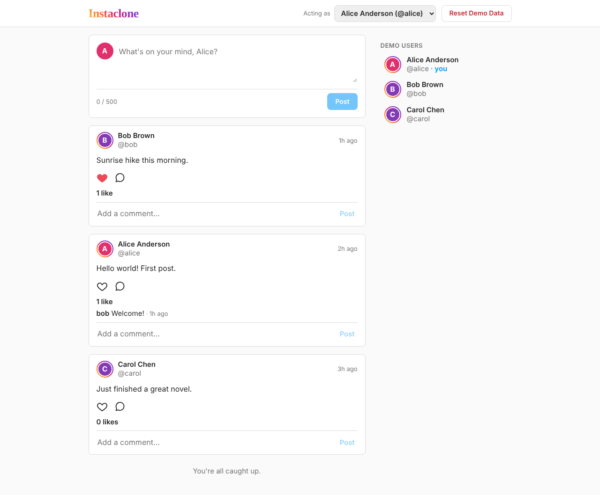 | 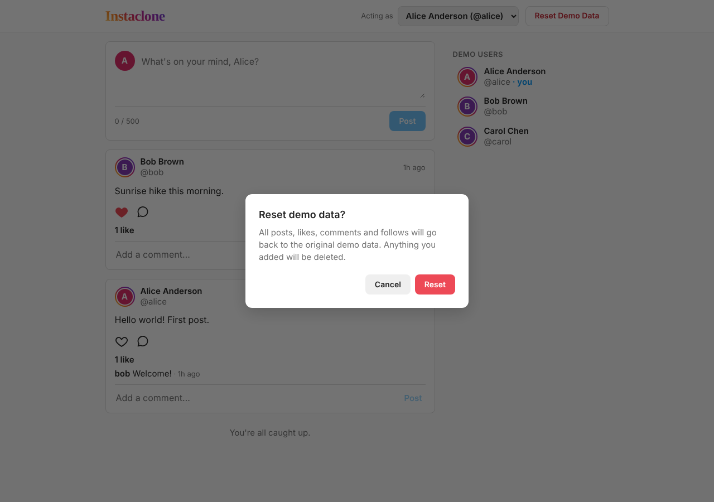 |
| **Mobile feed** | **Mobile profile** |
| 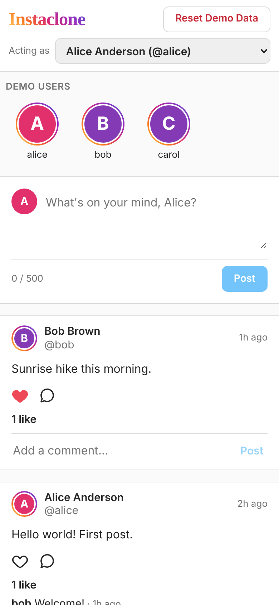 | 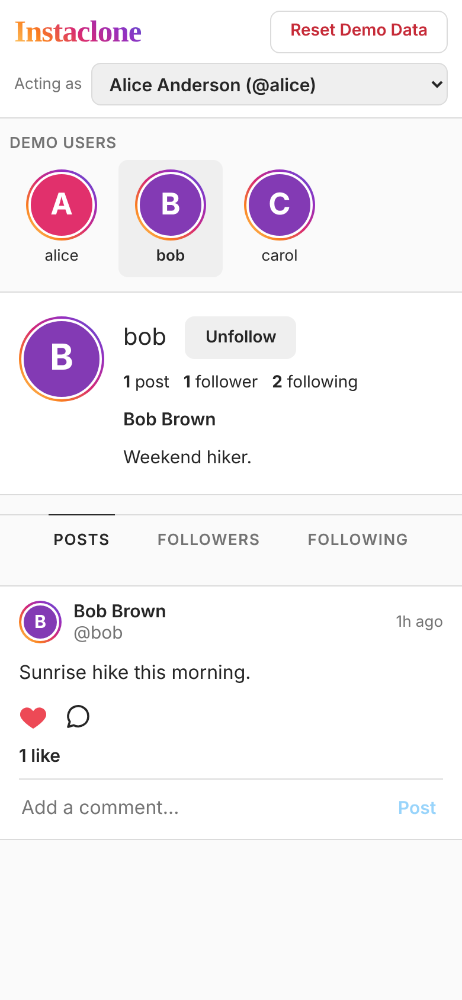 |

## Known limitations

- **No real authentication.** Anyone can act as any user by setting the header. This is
  by design for the MVP.
- **No pagination.** Feeds and profiles return every matching post. The design targets
  about 1,000 posts and hasn't been load tested.
- **Reset has a tiny race.** H2 commits immediately when it restarts ID counters, so that
  step runs just before the reset transaction. A post created in that instant could fail;
  pressing reset again fixes it.
- **Relative times** ("5m ago") update when data refreshes, not on a timer.
- **Not verified:** browsers other than Chromium (Safari, Firefox), real phones, an
  actual screen reader, and running on a JDK 17 runtime (tests ran on JDK 21, compiled
  for Java 17).
- **Development setup only.** The backend doesn't serve the built frontend, and there's
  no Docker or CI configuration.
- **ESLint 9** is past its support window; npm warns on install. Moving to ESLint 10 is a
  separate upgrade.

## Future improvements

- Real authentication, then authorization on every endpoint.
- Keyset pagination on `(created_at, id)`, using the existing index.
- Optimistic UI updates for likes and follows.
- Editing and deleting posts and comments; image uploads.
- A single deployable JAR serving the built frontend; Docker Compose; PostgreSQL for
  anything beyond local use.
- CI (for example GitHub Actions) running all three test suites on every push.
- Cross-browser and real-device test runs.

## Repository layout

```
backend/            Spring Boot app (Maven wrapper, Flyway migration, tests)
frontend/           React + TypeScript app (Vite), unit tests in src/, browser tests in e2e/
docs/screenshots/   Screenshots captured from the running app
docs/demo/          Walkthrough video and its poster image
REQUIREMENTS.md     Requirements, edge cases, acceptance criteria
ARCHITECTURE.md     Design: modules, schema, API, feed logic
PROMPTS.md          Prompts used to build the project
```
